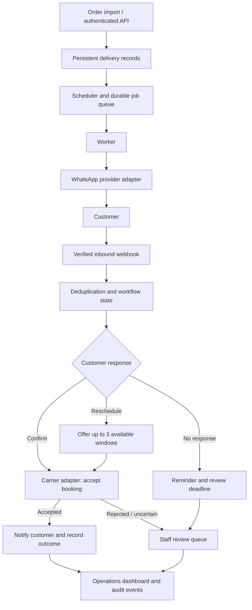

# Dispatch Desk
### Delivery confirmation automation | Python · Streamlit · WhatsApp workflows

**A portfolio case study by Hardik Raote**

Dispatch Desk is a delivery confirmation and rescheduling automation project. It helps operations teams ask customers to confirm upcoming deliveries, offer alternative windows, and escalate unanswered or uncertain cases for staff review.

> **Public showcase, private source.** This repository contains architecture and project documentation only. The full application, provider credentials, and implementation code are not published here.

## At a glance

| Challenge | Approach |
| --- | --- |
| Manual delivery confirmation | Scheduled WhatsApp confirmation workflow |
| Customer needs a different slot | Offer carrier-provided alternatives and record accepted choice |
| Customer does not respond | Send one reminder, then flag for staff review before dispatch |
| Duplicate or uncertain external actions | Deduplication, durable job records, idempotency contracts and manual review |
| Limited operational visibility | Dashboard, event history, status filters and exportable demo reports |

## Product walkthrough

The **interactive Streamlit demo** runs with simulated messaging and carrier services. It starts with three sample orders and lets a reviewer explore:

1. **Confirm:** A customer accepts the original delivery window; the simulated carrier accepts the booking.
2. **Reschedule:** A customer selects a new window from simulated carrier options.
3. **No response:** The system sends one simulated reminder and escalates an unresolved delivery.
4. **Staff review:** An operator acknowledges an alert while the delivery remains in review.
5. **Failure scenarios:** Simulate carrier rejection or an expired rescheduling offer.
6. **Reporting:** Inspect activity and export simulated delivery records as CSV or JSON.

**Recorded demo:** A 35-second captioned walkthrough exists in the private implementation repository. It can be published separately here after review.

## System architecture

The diagram describes the designed workflow. The **Streamlit demo uses simulated providers**; live operation requires WhatsApp setup, a real carrier adapter and hosting.

## Technology

| Layer | Technology / design |
| --- | --- |
| Backend | Python, HTTP API and background worker |
| Demo | Streamlit with isolated simulated sessions |
| Storage | SQLite for local/demo use; PostgreSQL supported for hosted backend |
| Messaging | WhatsApp Cloud API integration configuration and signed inbound webhooks |
| Carrier | Shipping adapter contract with booking confirmation and rescheduling |
| Reliability | Durable jobs, worker leases, deduplication and uncertain-outcome review |
| Validation | Automated backend and Streamlit tests with GitHub Actions |

## Reliability and safety

- **Customer consent:** Delivery imports record WhatsApp opt-in before messaging.
- **Verified webhooks:** Inbound WhatsApp events are validated using the provider's signature.
- **Duplicate prevention:** Repeated inbound message IDs are deduplicated.
- **External action uncertainty:** A crash between a successful provider call and a database commit can leave an uncertain outcome. Exactly-once external messaging is **not guaranteed**.
- **Conservative retries:** Uncertain customer sends require review rather than automatic replay.
- **Carrier acceptance:** The workflow only reports booking success after the carrier adapter accepts it.
- **Human oversight:** A staff review flag is an alert, **not** an automatic dispatch hold or carrier manifest change.

Read more in [Architecture](docs/architecture.md) and [Reliability & limitations](docs/reliability-and-limitations.md).

## Timing defaults

| Workflow event | Default |
| --- | --- |
| First confirmation request | 24 hours before delivery |
| Reminder | 6 hours after first message |
| Staff review deadline | 2 hours before dispatch |
| Rescheduling offer expiry | 15 minutes |
| Worker polling interval | 30 seconds |

These values are configurable in the implementation.

## Project scope

**Implemented / demonstrated:** Interactive Streamlit simulator, customer response scenarios, staff alerts, dashboard and report exports, Python backend, durable operations and automated tests.

**Integration-ready, not presented as deployed:** WhatsApp live configuration, carrier adapter contract and PostgreSQL hosting path.

**Not included:** An installed Shopify app, live carrier deployment, automated dispatch holds, booking edits, opt-out automation and delivery-receipt analytics. The retailer pilot supports authenticated bulk imports and a consent-gated Shopify CSV preparation workflow, not a live Shopify app.

## Explore

- [Architecture and workflow](docs/architecture.md)
- [Reliability, safeguards and limitations](docs/reliability-and-limitations.md)
- [Demo walkthrough](docs/demo-walkthrough.md)
- [Project summary for recruiters](docs/project-summary.md)

## About the developer

**Hardik Raote** · AI / ML and Python developer

[LinkedIn](https://www.linkedin.com/in/hardikraote/) · [GitHub](https://github.com/Hardik0801)

**Source availability:** The application source is kept private. Contact me through LinkedIn to discuss implementation choices and arrange a technical walkthrough.
