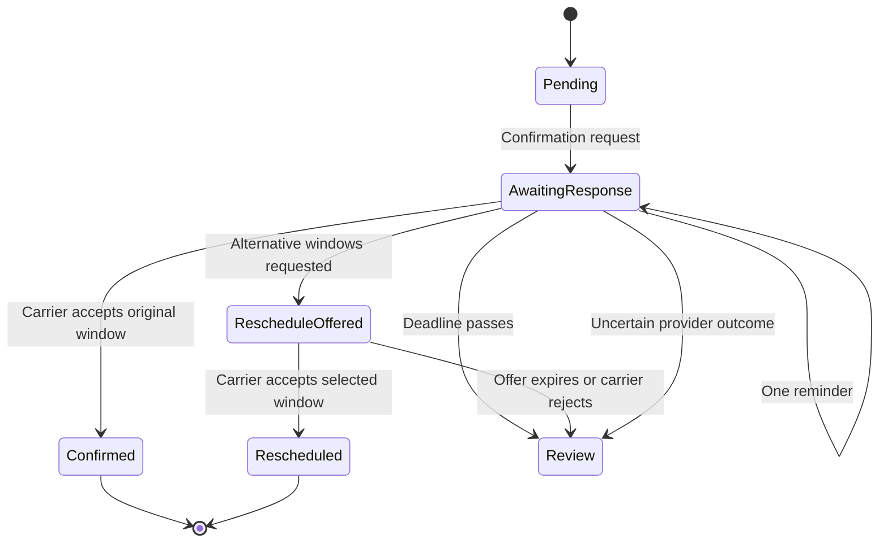

# Architecture and workflow

Dispatch Desk separates delivery state, scheduling, external provider actions and staff oversight.

## Components

1. **Order import:** An authenticated API imports scheduled deliveries. A retailer pilot also prepares Shopify CSV records for reviewed import.
2. **Storage:** Delivery records, events, inbound message identifiers, alerts and job ledger are persisted in SQLite or PostgreSQL.
3. **Scheduler:** Due deliveries are converted into background operations.
4. **Workers:** Workers claim durable jobs and call provider gateways outside the database transaction.
5. **Messaging gateway:** WhatsApp templates request confirmation and reminders. Signed webhooks receive supported button responses.
6. **Carrier adapter:** Checks and accepts original or alternative delivery windows through an adapter contract.
7. **Operations UI:** Dashboard presents order status, alerts, history and review actions.

## State flow

This is a simplified conceptual model, not a literal dump of the internal database states.

## Important boundaries

- The Streamlit demonstration **does not send live messages or book real carriers**.
- A booking is successful only after the carrier adapter accepts it.
- A staff review status does not prevent a vehicle leaving. Dispatch teams must act on review items.
- Acknowledging an alert marks it seen; it does not resolve the underlying delivery.

## Implementation separation

The source implementation is private. This public case study intentionally excludes API tokens, customer data, configuration secrets, and proprietary source files.
